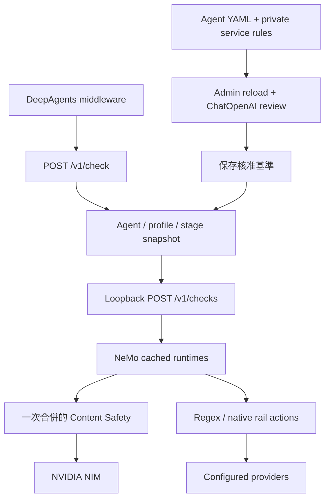

# NeMo Agent Guardrails PoC

以官方 `nemoguardrails server`（0.24.1）提供 Agent 文字輸入／輸出檢查。
使用原生 Rails Runtime、Cache、Checks API，透過 Server Extension 加入管理與檢查路由；沒有修改 NeMo，也沒有另一個 HTTP server。

## 啟動

需要 Python 3.12。以下命令在專案根目錄執行：

```bash
python3.12 -m venv .venv
.venv/bin/python -m pip install -r requirements.lock -e '.[agent,native,test]'
cp .env.example .env  # 已有 .env 時保留原檔
chmod 600 .env
```

填入 `.env` 的 `NVIDIA_API_KEY`、`LLM` 與至少 24 字元的 `GUARDRAIL_ADMIN_KEY`。
Content Safety 與 generation model 使用不同模型；generation model 同時用於 Policy 衝突審核與 Agent。
`.env` 不執行 shell 表達式；範例中的空白欄位須填入實際值。

```bash
./server.sh
```

在另一個 terminal 呼叫 DeepAgents 範例：

```bash
.venv/bin/python http_guardrail_demo.py '簡短解釋曝光微影' --agent-id yield_agent
```

範例在 `before_agent` 檢查所有帶入訊息，在 model wrapper 檢查每次模型回應；被阻擋時不釋出答案。

## 設定

| 路徑 | 用途 |
|---|---|
| `configs/guardrails.yaml` | Agent → profile → input/output checks；供未來管理介面編輯 |
| `service/company.yaml` | Service 管理者維護的強制 Content Safety 規則，目前為禁止直接執行 SQL 的示範 |
| `service/default_content_safety.txt` | 官方預設分類規則，選擇 `mode: default` 時納入 |
| `service/native_rails.yaml` | Service 管理者啟用的 native rail presets、參數與 prompts |
| `configs/*_shared/` | 三組原生 Rails runtime 定義；跨 Agent 共用並由 NeMo 快取 |
| `service/state/` | 私有核准基準，防止重啟繞過已拒絕的更新；不進 Git |

公司規則永遠執行。相同 stage 的公司規則、Agent custom policies，以及有選用的 default taxonomy，會合併成一次 Content Safety 分類。
其他 rails 依 profile 順序執行，所有 checks 通過才回傳 ALLOW。
原始公司規則與合併 prompt 不回傳給呼叫端。

修改 YAML 後，由管理者送出：

```bash
curl --fail-with-body -X POST http://127.0.0.1:8000/v1/admin/reload \
  -H "X-Admin-Key: $GUARDRAIL_ADMIN_KEY"
```

此命令的 shell 須先設定與 `.env` 相同的管理 key；server 讀取 `.env` 不會設定另一個 terminal 的變數。
變更的政策由 ChatOpenAI 與公司、default 及該 Agent 的既有政策比較；相容才保存核准基準並原子替換 snapshot。
明確衝突回 409，審核不可用回 503；兩者都保留舊設定。單純省略舊限制不視為明確衝突，政策不會永久累積歷史文字。
請求執行期間固定使用同一版 snapshot，更新政策不重建 NeMo runtime。
程式、環境變數、模型與 provider 資源變更需要重啟；目前以單一 process 管理設定。

## HTTP API

```bash
curl --fail-with-body http://127.0.0.1:8000/v1/check \
  -H 'Content-Type: application/json' \
  -d '{"agent_id":"yield_agent","stage":"before_model","payload":{"text":"Explain lithography."},"context":{}}'
```

`stage` 保留 Middleware schema 的 `before_model`／`after_model`，分別對應服務的 input／output。
Agent 範例的輸入 hook 是 `before_agent`，並不代表每次模型呼叫前重複檢查。
`GET /v1/guardrail-catalog` 提供目前 NeMo manifests 與可選 preset 狀態。
未知 Agent、檢查失敗、分類不完整及 provider 錯誤都不放行。

## 測試與範圍

```bash
.venv/bin/python -m pytest -q
# 讀取專案 .env，執行會使用額度的 NIM live tests：
.venv/bin/python scripts/run_live_tests.py
# 額外執行完整的 NIM Agent + service 路徑：
RUN_HTTP_AGENT_LIVE=1 .venv/bin/python -m pytest -q tests/test_http_guardrails_server.py -k live
```

Offline 測試以明確 fixture 驗證流程；不宣稱 stub 能判讀自然語言政策。
Live 測試須收到實際解析成功的 NIM 分類，provider 錯誤造成的 DENY 不算通過。
測試僅在暫存目錄啟動官方 server、修改設定，不產生 repository 內的測試報告。
前次整理後的 offline/server integration 驗證為 208 passed、6 skipped；最近 live 嘗試遇到 NIM 429 與 policy review 503，尚未完成整輪重驗。

支援 input/output adapter 的 rails 不等於所有外部 provider 已部署或經過 live 驗收。
預設可用的其他 presets 為 context bloat 與 YARA injection；其他 native presets 必須由管理者設定依賴、模型或 endpoint 後啟用。
目前沒有 streaming、工具執行、retrieval 或 masking 回寫整合；Agent 範例只接受文字並阻擋工具呼叫。

**存取邊界：**對 Agent 只開放 `/v1/check`（及有需要的 catalog）。原生 `/v1/checks` 等端點可繞過公司 registry 政策，需由 gateway／ACL 阻擋外部存取。
目前尚未實作 Agent 註冊、身分驗證、擁有權與 WebUI；`agent_id` 是設定映射。
正式公司規則由 service 管理者私下部署，本 repository 只含示範規則。

## 設計



完整流程：[service-design.mmd](docs/service-design.mmd)。
官方預設 prompt 的固定 revision、SHA256 與來源授權資訊保留於 [來源紀錄](service/default_content_safety.source.json)。
